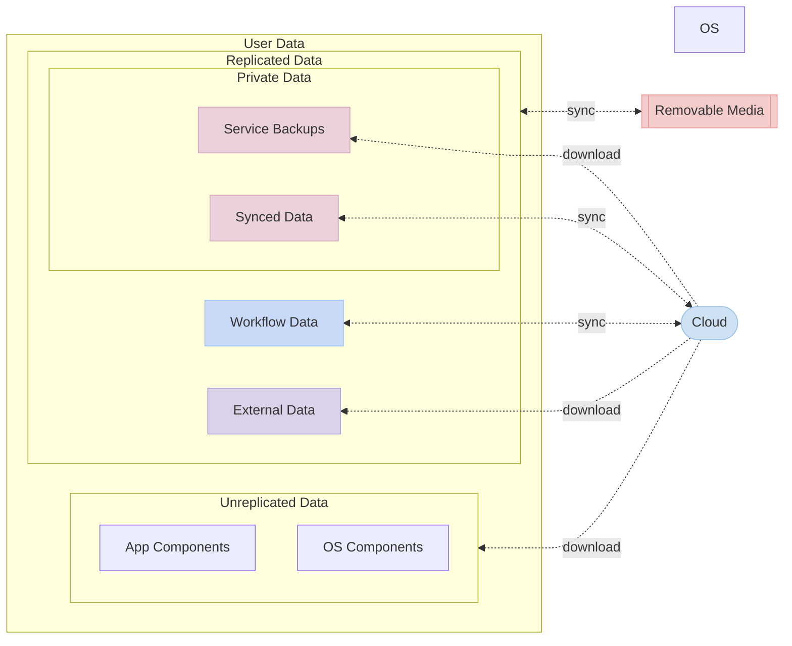
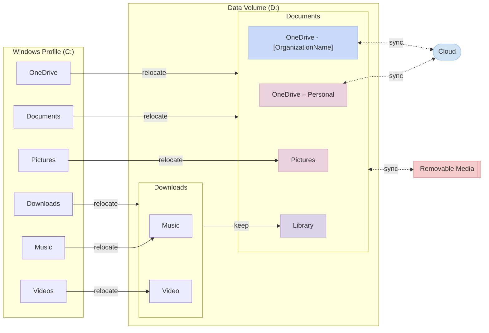
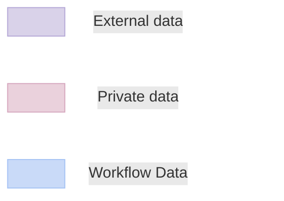
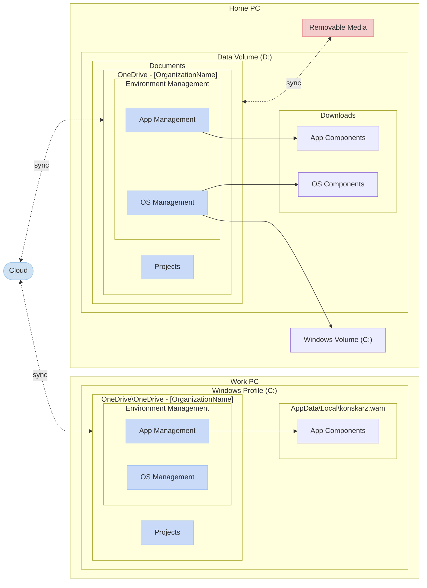

# Personal Computing Method

> Organize and manage digital work and tools in a way that separates concerns, controls replication, and supports reproducibility, to maintain control over data and workflows, reduce risk of data loss, and ensure consistent environments across devices.

## Data Management

In the Linux world, keeping `/home` on a separate disk partition is commonplace. For most Windows users, however, this is something of an exotic practice. Yet there are compelling reasons for such a separation. The lifecycle of an OS installation is considerably shorter than that of the user's data.

What about the software we download from the Internet and install on our computers? Shouldn't that also be considered part of our data? In one sense, it certainly is: each of us chooses the software we want to use. In another sense, however, the same software can be used independently by many different people. Perhaps installed software has a lifecycle that coincides with that of the operating system? For some applications, the answer is clearly yes — a printer driver or Microsoft Office, for example. For others, it is not so clear. PortableApps.com Platform is a good example of software designed to exist independently of a particular Windows installation.

Do we need to care about preserving our data at all? Absolutely. It is also worth keeping a backup of data held by external services. Replication, in one form or another, is what makes this possible. However, replication comes at a cost: first and foremost, it takes time. Software packages and operating system images can be quite large. But do we really need to replicate them? Not necessarily. They can usually be downloaded again whenever needed. Their lifecycle may extend beyond that of the operating system, but there is no particular reason for them to outlive the computer itself.

A sound data replication strategy aimed at preserving data should begin with two questions: "What?" and "How?" The answers "Everything" and "In cloud storage" are hardly optimal. As we have seen, there is usually little reason to replicate content that is publicly available online and can be downloaded again. This applies to much more than operating systems and software. It is worth noting that not everything we download from the Internet is worth keeping in the first place. Another practical question would be: "Which of the things available online do we want to be able to access offline?" Even so, a carefully selected collection of data worth replicating can easily amount to tens or even hundreds of gigabytes. For such volumes, offline replication may be a more practical approach.

Offline replication also makes it possible to use a replica to transfer data between devices. A smartphone, for example, can even serve as a carrier for a replica. Nor does it rule out the use of cloud services for data that is frequently updated and edited across multiple devices. When using cloud storage, it is also natural to keep work-related and personal data separate.

- **User Data**: separate OS and user data to reduce risk of data loss
- **Replicated Data**: separate data that should be replicated locally to reduce risk of loss and ensure availability offline across devices
- **Unreplicated Data**: separate data that doesn’t need replication to optimize storage usage
- **App Components**: portable apps, packages
- **OS Components**: OS images, drivers, updates
- **Workflow Data**: separate workflow data, synchronized via services to keep it editable across devices
- **Private Data**: separate personal data from workflow data to maintain control and privacy
- **Service Backups**: backup personal data from external services to reduce risk of loss
- **Synced Data**: separate personal data synchronized via services to keep it editable across devices
- **External Data**: separate data for consumption, created by others, to avoid mixing with personal workflows and ensure availability offline across devices
- **Removable Media**: External storage (e.g., SD-card, phone storage) for local replication to ensure availability offline across devices
- **Cloud**: Cloud Libraries, Services, Storage, Version Control Systems for data consumption and synchronization across devices, use online sync only for actively edited data

## User Profile

Windows provides no supported way to relocate the entire user profile — `%USERPROFILE%` (normally `C:\Users\<username>`) — to a separate partition. Moreover, [Microsoft](https://learn.microsoft.com/en-us/windows-hardware/customize/desktop/unattend/microsoft-windows-shell-setup-folderlocations-profilesdirectory) does not recommend using even the profile-relocation mechanism — `ProfilesDirectory` (normally `C:\Users`) — that is provided for deployment purposes.

Windows provides built-in support for relocating `Contacts`, `Desktop`, `Documents`, `Downloads`, `Favorites`, `Links`, `Music`, `Pictures`, `Saved Games`, `Searches`, `Videos` folders (`Properties → Location → Move`). The `OneDrive` folder location can be changed through the OneDrive client. On a single-user Windows system, a practical starting point is to relocate `Documents` and `Downloads` to the data volume, for replicated and unreplicated data, respectively. `Documents` is the natural entry point for data that users create and edit. `Downloads` is the standard destination for files arriving from external sources. Anything worth keeping for future reference or offline access can be manually moved from `Downloads` to `Documents\Library`.

Photos and videos created by users, increasingly captured on smartphones, represent personal content whose lifecycle is independent of the computer on which it is stored. Keeping them together in `Documents\Pictures` also reflects the way users commonly create and manage this content. Music and video, by contrast, are predominantly consumed rather than created by users. The corresponding Windows folders can be relocated to `Downloads\Music` and `Downloads\Video`.

`OneDrive` is treated as a separate cloud storage location mapped to `Documents`. Personal and work-related data are kept separate within it. This is incompatible with OneDrive's Known Folder Move feature, which redirects `Documents` into `OneDrive`. Long-term storage of files on the `Desktop` is not optimal. It is better treated as a temporary workspace. Other user profile folders are outside the scope of this mapping due to their specialized roles.

## Environment Management

A freshly installed operating system runs faster and more reliably than one that has been in use for a long time. But how difficult is the process of installing an operating system in the first place? Can it be simplified or accelerated? To some extent, yes. Could we use preconfigured Windows installation images containing all the software we need? Probably not. Preparing and testing them would take more time than they save, and such images would quickly become outdated. Windows deployment can be made somewhat faster with DISM. However, the bulk of the time is not spent deploying the operating system itself, but rather installing and configuring the software we need. This software is what constitutes our personal computing environment.

One possible solution is to write scripts that automate software deployment and run them after each operating system installation. This can be an effective approach, provided that the number of applications to be deployed remains manageable, and that individual scripts can be easily added or removed. In this way, preparing the operating system environment becomes a routine, repeatable process. Unlike operating system images and software packages, OS management and automation tools require very little disk space and can be portable across devices. Their lifecycle is aligned with that of the user's data selected for replication.

Let's return to PortableApps.com Platform, and this time take a look at its [Portable App Guidelines](https://portableapps.com/about/what_is_a_portable_app#guidelines). In my view, everything described there is relevant not only to separating the operating system from the software environment, but also to maintaining good OS hygiene on the part of the software running on it. Yes, the bulk of the software environment can be independent of a particular OS installation. However, it is still too large to be practical to replicate in its entirety, especially when much of it can simply be downloaded again. The real problem is that application settings and user-specific configuration data are still tightly coupled to the software environment itself.

Today, if we favor open-source software, many Windows applications will either be portable by design or can be made portable with relatively little effort through scripting. The problem lies in the sheer variety of things that need to be configured, and, more importantly, in distinguishing actual user settings from internal application data. Scripting, combined with storing application settings in the portion of user data selected for replication, remains a sensible strategy. This results in a management environment consisting of scripts and executable files from WAM and WPT projects, together with user configuration data. Occupying a few megabytes of disk space, it provides the automation needed to deploy the operating system and manage software that may occupy tens of gigabytes once downloaded and deployed.

- **App Management**: separate app management, used for portability, automation, and workspace integration to enable reproducible workflows across devices, and synchronize it via services to keep it editable across devices
- **OS Management**: separate OS management, used for setup, recovery, and post-install tasks automation, to maintain stable environments, and synchronize it via services to keep configurations consistent across devices
